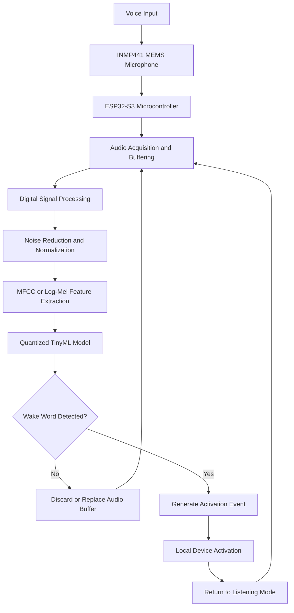
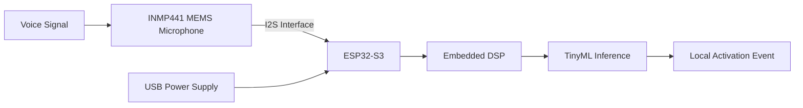

# 🎙️ EdgeWake – Low Latency and Efficient Voice Activator for Edge Devices

An Edge AI-based voice activation system designed to enable low-latency, resource-efficient and offline wake-word detection using Digital Signal Processing (DSP), Tiny Machine Learning (TinyML) and ESP32-S3 microcontroller technology.

The project combines audio signal processing, lightweight neural networks and embedded intelligence to explore efficient voice activation on resource-constrained edge devices.

🔗 GitHub Repository:\
[EdgeWake](https://github.com/srishtii26/EdgeWake)

---

# 🚀 Overview

Conventional voice assistants often depend on cloud-based processing, resulting in network dependency, increased latency, power consumption and potential privacy concerns.

EdgeWake proposes an intelligent voice activation system capable of detecting predefined wake words directly on edge devices.

The system is designed to:

- Capture real-time audio signals
- Process microphone input
- Reduce background noise
- Extract relevant speech features
- Detect predefined wake words
- Minimize false activations
- Reduce computational overhead
- Enable offline wake-word detection
- Improve user privacy
- Support resource-constrained embedded devices

Built around Python, Digital Signal Processing, TinyML and ESP32-S3 technology.

---

# 🏆 Smart India Hackathon

| Parameter | Details |
|---|---|
| Project Name | EdgeWake |
| Problem Statement ID | SIH26172 |
| Problem Statement | Low Latency and Efficient Voice Activator for Edge Devices |
| Organization | Indian Space Research Organisation (ISRO) |
| Category | Hardware |
| Theme | Miscellaneous |
| Domain | Edge AI, Embedded Systems and DSP |

---

# 💡 Problem Statement

Modern voice-enabled devices require continuous audio monitoring to detect activation commands.

Traditional voice activation systems face several challenges:

- High computational requirements
- Increased power consumption
- Cloud dependency
- Network latency
- Background noise interference
- False wake-word activation
- Limited embedded memory
- Audio privacy concerns

The captured audio signal can be mathematically represented as:

$$x(n)=s(n)+v(n)$$

Where:

- $x(n)$ — Captured audio signal
- $s(n)$ — Original speech signal
- $v(n)$ — Background noise component

The primary objective is to develop a lightweight and efficient voice activation system capable of identifying a predefined wake word while minimizing latency, memory utilization and computational overhead.

---

# 🎯 Solution

EdgeWake proposes a multi-stage edge intelligence architecture.

## Stage 1 — Audio Acquisition

- Real-time microphone input
- Digital audio sampling
- Continuous audio monitoring
- Audio frame buffering

## Stage 2 — Digital Signal Processing

- Background noise reduction
- Signal normalization
- Audio segmentation
- Window-based signal processing

## Stage 3 — Feature Extraction

- Mel-Frequency Cepstral Coefficients (MFCC)
- Log-Mel Spectrograms
- Frequency-domain speech analysis
- Compact feature representation

## Stage 4 — TinyML Wake-Word Detection

- Lightweight neural network
- Custom keyword spotting
- INT8 model quantization
- Local inference
- Confidence-based classification

## Stage 5 — Device Activation

- Wake-word recognition
- Activation event generation
- Local device control
- Return to continuous listening

The proposed architecture minimizes unnecessary processing and eliminates cloud dependency for wake-word detection.

---

# ✨ Features & Development Scope

## 🎧 Audio Signal Processing

- Real-Time Microphone Input
- Digital Audio Acquisition
- Audio Frame Segmentation
- Signal Normalization
- Background Noise Reduction
- Continuous Audio Monitoring

---

## 📡 Speech Feature Extraction

- Fast Fourier Transform (FFT)
- Short-Time Fourier Transform (STFT)
- Mel-Frequency Cepstral Coefficients (MFCC)
- Log-Mel Spectrogram Analysis
- Frequency-Domain Feature Extraction
- Compact Audio Feature Representation

---

## 🧠 Artificial Intelligence & TinyML

- Custom Wake-Word Detection
- Keyword Spotting (KWS)
- Lightweight Convolutional Neural Networks
- Depthwise Separable CNN Architecture
- INT8 Model Quantization
- Confidence-Based Classification
- On-Device Machine Learning
- Resource-Efficient Inference

---

## ⚡ Embedded Intelligence

- ESP32-S3 Microcontroller
- I2S MEMS Microphone Integration
- Low-Latency Voice Activation
- Continuous Edge-Based Listening
- Local Device Activation
- Memory-Efficient Processing
- Offline Wake-Word Detection

---

## 🔐 Privacy & Security

- Local Audio Processing
- No Continuous Cloud Audio Transmission
- No Internet Dependency for Wake-Word Detection
- Reduced Audio Data Exposure
- Local Wake-Word Classification
- Temporary Audio Buffer Management

---

## 📊 Performance Evaluation

- Wake-Word Detection Accuracy
- False Activation Rate
- False Rejection Rate
- Inference Latency
- RAM Utilization
- CPU Utilization
- Power Consumption
- Background Noise Robustness

---

## 🖥️ Desktop Prototype

- Python-Based Voice Activation Prototype
- PySide6 Graphical User Interface
- Real-Time Audio Capture
- Speech Recognition Experimentation
- Microphone Monitoring
- Wake-Word Activation Status
- Local Speech Recognition Exploration

The desktop prototype is intended to support initial experimentation before deployment on embedded hardware.

---

# 🛠️ Tech Stack

## Programming Languages

- Python
- C
- C++

## Development Environment

- Visual Studio Code
- Arduino IDE
- ESP-IDF

## Artificial Intelligence & Machine Learning

- TensorFlow
- TensorFlow Lite
- TensorFlow Lite Micro
- TinyML
- Convolutional Neural Networks (CNN)
- Depthwise Separable CNN (DS-CNN)
- Keyword Spotting (KWS)
- INT8 Quantization

## Digital Signal Processing

- Digital Signal Processing (DSP)
- Fast Fourier Transform (FFT)
- Short-Time Fourier Transform (STFT)
- Mel-Frequency Cepstral Coefficients (MFCC)
- Log-Mel Spectrograms
- Audio Signal Normalization
- Noise Reduction

## Desktop Prototype Technologies

- Python
- NumPy
- SoundDevice
- PySide6
- Vosk / Faster-Whisper (Experimental)

## Hardware Components

- ESP32-S3 Development Board
- INMP441 I2S MEMS Microphone
- Breadboard
- Jumper Wires
- USB Cable

## Version Control

- Git
- GitHub

The technologies listed include both desktop experimentation tools and the proposed embedded implementation stack.

---

# 🏗️ System Architecture



---

# 🔬 Project Methodology

## 1️⃣ Audio Signal Acquisition

The INMP441 MEMS microphone captures environmental audio signals.

The microphone communicates with the ESP32-S3 microcontroller through the Inter-IC Sound (I2S) interface.

The captured digital audio is stored temporarily in an audio buffer for further processing.

---

## 2️⃣ Audio Preprocessing

The captured audio signal undergoes preprocessing to improve the quality of speech features.

The preprocessing stage may include:

- Background noise reduction
- Signal normalization
- Audio segmentation
- Windowing
- Removal of unwanted signal components

Signal normalization can be represented as:

$$x_{norm}(n)=\frac{x(n)}{\max(|x(n)|)+\epsilon}$$

Where:

- $x(n)$ — Input audio signal
- $x_{norm}(n)$ — Normalized audio signal
- $\epsilon$ — Small constant preventing division by zero

---

## 3️⃣ Audio Frame Segmentation

Continuous audio signals are divided into short overlapping frames.

Speech signals can be approximately stationary over short time intervals, enabling efficient frequency-domain analysis.

A Hamming window can be applied to each frame:

$$w(n)=0.54-0.46\cos\left(\frac{2\pi n}{N-1}\right)$$

Where:

- $w(n)$ — Window coefficient
- $N$ — Frame length
- $n$ — Sample index

Windowing helps reduce spectral leakage during frequency-domain analysis.

---

## 4️⃣ Frequency-Domain Analysis

The Fast Fourier Transform converts time-domain audio samples into their frequency-domain representation.

The Discrete Fourier Transform is represented as:

$$X(k)=\sum_{n=0}^{N-1}x(n)e^{-j2\pi kn/N}$$

Where:

- $x(n)$ — Time-domain audio signal
- $X(k)$ — Frequency-domain representation
- $N$ — Number of samples
- $k$ — Frequency index

The frequency-domain representation enables the extraction of relevant speech characteristics.

---

## 5️⃣ MFCC Feature Extraction

Mel-Frequency Cepstral Coefficients provide a compact representation of speech characteristics based on human auditory perception.

The frequency-to-Mel conversion is represented as:

$$m=2595\log_{10}\left(1+\frac{f}{700}\right)$$

Where:

- $m$ — Mel-scale frequency
- $f$ — Frequency in Hertz

The MFCC extraction process includes:

- Audio framing
- Windowing
- Fast Fourier Transform
- Mel filter bank processing
- Logarithmic energy calculation
- Discrete Cosine Transform

The resulting features are provided as input to the wake-word detection model.

---

## 6️⃣ Custom Wake-Word Model Training

A lightweight neural network is trained to classify audio features.

The proposed training dataset consists of:

- Target wake-word recordings
- Similar-sounding words
- Unknown speech samples
- Background noise samples
- Silence samples
- Recordings from different speakers

The initial target wake word is:

**"Hey"**

The model is designed to distinguish the target keyword from unrelated speech and environmental noise.

A longer custom wake word may be evaluated to reduce accidental activation.

---

## 7️⃣ TinyML Model Optimization

The trained neural network is optimized for embedded deployment using model quantization.

INT8 quantization converts floating-point model parameters into lower-precision integer representations.

The quantization operation can be represented as:

$$q=\operatorname{clip}\left(\operatorname{round}\left(\frac{r}{S}\right)+Z,-128,127\right)$$

Where:

- $r$ — Original floating-point value
- $q$ — Quantized integer value
- $S$ — Quantization scale
- $Z$ — Zero-point

Model optimization is intended to:

- Reduce model size
- Minimize memory requirements
- Reduce computational complexity
- Improve inference efficiency
- Support resource-constrained microcontrollers

---

## 8️⃣ On-Device Wake-Word Detection

The optimized TinyML model is intended to run locally on the ESP32-S3 microcontroller.

The model generates a wake-word confidence score.

The activation decision is represented as:

$$A=\begin{cases}
1, & P(wake)\geq\tau\\
0, & P(wake)<\tau
\end{cases}$$

Where:

- $A$ — Activation decision
- $P(wake)$ — Predicted wake-word probability
- $\tau$ — Detection confidence threshold

When the confidence score exceeds the configured threshold, the device generates an activation event.

---

## 9️⃣ Device Activation

After successful wake-word detection, the system can trigger a predefined local action.

Potential activation operations include:

- Activating an embedded subsystem
- Initiating an IoT operation
- Enabling a voice-controlled interface
- Triggering a local software event
- Starting a subsequent command-processing module

The system then returns to continuous listening mode.

---

# ⚙️ Proposed System Configuration

| Parameter | Configuration |
|---|---|
| Microcontroller | ESP32-S3 |
| Microphone | INMP441 MEMS |
| Communication Interface | I2S |
| Sampling Frequency | 16 kHz |
| Audio Resolution | 16-bit PCM after conversion |
| Audio Channel | Mono |
| Frame Duration | 25 ms |
| Frame Stride | 10 ms |
| Feature Extraction | MFCC / Log-Mel |
| Proposed Model | Lightweight CNN / DS-CNN |
| Model Optimization | INT8 Quantization |
| Inference Framework | TensorFlow Lite Micro |
| Initial Wake Word | Hey |
| Processing Mode | Offline Edge Processing |
| Internet Requirement | Not Required for Wake-Word Detection |
| Cloud Dependency | None for Offline Variant |
| Target RAM Utilization | Below 256 KB |
| Target Idle CPU Utilization | Below 10% |
| Detection Threshold | To Be Experimentally Optimized |

The configurations represent proposed design parameters and are subject to experimental validation.

---

# 🔌 Hardware Architecture



---

# 💰 Estimated Hardware Budget

| Component | Estimated Cost |
|---|---:|
| ESP32-S3 Development Board | ₹700–₹1,200 |
| INMP441 MEMS Microphone + USB Cable | ₹200–₹450 |
| Breadboard + Jumper Wires | ₹130–₹250 |
| Optional Indicators + Miscellaneous | ₹50–₹100 |
| **Total Estimated Budget** | **₹1,080–₹2,000** |

The proposed system uses affordable and readily available embedded hardware components.

No recurring cloud subscription is required for the offline wake-word detection variant.

---

# 📁 Proposed Project Structure

```text
EdgeWake/
│
├── desktop/
│   ├── main.py
│   ├── audio_capture.py
│   ├── wake_word.py
│   └── interface.py
│
├── embedded/
│   ├── main.cpp
│   ├── audio_processing.cpp
│   ├── feature_extraction.cpp
│   └── model_data.h
│
├── training/
│   ├── train_model.py
│   ├── preprocess.py
│   └── quantize_model.py
│
├── dataset/
│   ├── wake_word/
│   ├── unknown/
│   └── background_noise/
│
├── models/
│   └── edgewake_int8.tflite
│
├── results/
│   └── .gitkeep
│
├── docs/
│   └── architecture.md
│
├── requirements.txt
├── README.md
└── .gitignore
```

The above structure represents the recommended organization for the complete project. The current repository may contain a different set of files depending on the development stage.

---

# 📂 Proposed File Description

| File | Description |
|---|---|
| main.py | Desktop prototype execution script |
| audio_capture.py | Real-time microphone input |
| wake_word.py | Wake-word detection logic |
| interface.py | Graphical user interface |
| main.cpp | ESP32-S3 firmware entry point |
| audio_processing.cpp | Embedded audio preprocessing |
| feature_extraction.cpp | Embedded speech feature extraction |
| model_data.h | Quantized neural network model |
| train_model.py | Custom keyword spotting model training |
| preprocess.py | Audio dataset preprocessing |
| quantize_model.py | TinyML model optimization |
| edgewake_int8.tflite | Quantized wake-word model |
| dataset/ | Training and evaluation audio samples |
| results/ | Experimental performance results |
| requirements.txt | Python package dependencies |
| README.md | Project documentation |
| .gitignore | Git tracking configuration |

---

# ⚙️ Installation & Setup

## 1️⃣ Clone Repository

```bash
git clone https://github.com/srishtii26/EdgeWake.git
```

---

## 2️⃣ Navigate Into Project

```bash
cd EdgeWake
```

---

## 3️⃣ Open Visual Studio Code

```bash
code .
```

---

## 4️⃣ Create Python Virtual Environment

```bash
python -m venv .venv
```

Activate the virtual environment on Windows:

```powershell
.\.venv\Scripts\Activate.ps1
```

For Linux or macOS:

```bash
source .venv/bin/activate
```

---

## 5️⃣ Install Dependencies

If the repository contains a requirements file, execute:

```bash
pip install -r requirements.txt
```

Potential desktop prototype dependencies include:

```bash
pip install numpy sounddevice PySide6
```

For experimental offline speech recognition:

```bash
pip install faster-whisper
```

Speech recognition model files may need to be downloaded separately before offline execution.

---

## 6️⃣ Run Desktop Prototype

Execute the main Python entry-point file available in the repository.

For the proposed directory structure:

```bash
python desktop/main.py
```

The actual execution command depends on the current repository structure.

---

## 7️⃣ Embedded Hardware Setup

The proposed embedded deployment process includes:

- Install Arduino IDE or ESP-IDF
- Configure ESP32-S3 board support
- Connect the INMP441 microphone
- Configure the I2S audio interface
- Train the custom wake-word model
- Convert the model into INT8 TensorFlow Lite format
- Integrate TensorFlow Lite Micro
- Compile and upload the firmware
- Monitor detection events using the Serial Monitor

---

## 8️⃣ Test Wake-Word Detection

After successful firmware deployment:

- Speak the configured wake word
- Observe the activation event
- Test similar-sounding words
- Introduce background noise
- Evaluate false activations
- Measure inference latency
- Monitor memory and CPU utilization

---

# 📊 Performance Evaluation

The proposed system is evaluated using classification accuracy, wake-word detection reliability and embedded resource utilization.

## Detection Accuracy

$$Accuracy=\frac{TP+TN}{TP+TN+FP+FN}\times100$$

Where:

- TP — True Positive
- TN — True Negative
- FP — False Positive
- FN — False Negative

---

## True Positive Rate

$$TPR=\frac{TP}{TP+FN}\times100$$

The True Positive Rate measures the percentage of actual wake-word events correctly detected by the system.

---

## False Positive Rate

$$FPR=\frac{FP}{FP+TN}\times100$$

The False Positive Rate measures the proportion of negative samples incorrectly classified as wake words.

For continuous listening, false activations per hour should also be measured.

---

## False Rejection Rate

$$FRR=\frac{FN}{TP+FN}\times100$$

The False Rejection Rate measures the proportion of actual wake-word events missed by the system.

---

## Activation Latency

$$T_{activation}=t_{activation}-t_{keyword\_end}$$

Where:

- $t_{activation}$ — Time at which the activation event occurs
- $t_{keyword\_end}$ — Time at which the wake word ends

Lower activation latency indicates faster system responsiveness.

---

## CPU Utilization

$$CPU_{usage}=\frac{T_{active}}{T_{total}}\times100$$

CPU utilization measures the proportion of processing time consumed by the voice activation workload.

---

## Power Consumption

$$P=V\times I$$

Where:

- $P$ — Power consumption
- $V$ — Supply voltage
- $I$ — Current consumption

Power measurements help evaluate the suitability of the system for battery-powered edge devices.

---

## Performance Targets

| Performance Metric | Design Objective |
|---|---|
| Wake-Word Detection Accuracy | High |
| True Positive Rate | High |
| False Activation Rate | Near Zero |
| False Rejection Rate | Low |
| Activation Latency | Minimum Possible |
| RAM Utilization | Below 256 KB |
| Idle CPU Utilization | Below 10% |
| Power Consumption | Low |
| Noise Robustness | High |
| Internet Dependency | None for Offline Variant |

These values represent design objectives rather than experimentally measured results.

Hardware benchmarking and model validation are required before claiming that these targets have been achieved.

---

# 📸 Expected Outputs

The system is intended to generate the following outputs:

| Output | Description |
|---|---|
| Wake-Word Detection Status | Indicates keyword recognition |
| Confidence Score | Model prediction probability |
| Audio Waveform | Visualization of captured audio |
| MFCC Visualization | Extracted speech features |
| Confusion Matrix | Classification performance |
| Latency Report | Wake-word activation timing |
| Memory Report | Embedded RAM utilization |
| CPU Utilization Report | Processing efficiency |
| Power Consumption Report | Hardware energy requirements |

---

## 📈 Audio Signal Analysis

Audio waveform visualization can be used to compare:

- Original Microphone Signal
- Background Noise Signal
- Preprocessed Audio Signal
- Wake-Word Audio Segment

---

## 📊 Model Performance Analysis

The wake-word detection model can be evaluated using:

- Training Accuracy
- Validation Accuracy
- Training Loss
- Validation Loss
- Confusion Matrix
- False Activation Rate
- False Rejection Rate

---

## ⚡ Embedded Performance Analysis

The ESP32-S3 implementation will be evaluated for:

- Inference Latency
- Activation Latency
- RAM Utilization
- CPU Utilization
- Model Size
- Power Consumption

Verified experimental graphs and hardware demonstration images can be added after successful testing.

---

# 🌟 Technical Highlights

- Edge Artificial Intelligence
- Embedded Machine Learning
- Custom Keyword Spotting
- Offline Wake-Word Detection
- Real-Time Audio Signal Processing
- MFCC-Based Speech Feature Extraction
- Lightweight Neural Network Architecture
- INT8 Model Quantization
- TensorFlow Lite Micro Deployment
- ESP32-S3 Embedded Integration
- Resource-Efficient Inference
- Privacy-Oriented Architecture
- Low-Cost Hardware Design
- Low-Latency Voice Activation
- Modular System Architecture

---

# 🌍 Real-World Applications

## 🚀 Space & Aerospace Systems

- Hands-Free Embedded Interfaces
- Voice-Activated Monitoring Systems
- Offline Human-Machine Interfaces
- Resource-Constrained Embedded Intelligence
- Voice-Enabled Ground Support Systems

---

## 🏠 Smart Home & IoT

- Voice-Activated Home Automation
- Smart Lighting Control
- Intelligent IoT Devices
- Offline Smart Assistants
- Voice-Enabled Appliances

---

## 🏭 Industrial Automation

- Hands-Free Machine Interfaces
- Voice-Activated Equipment
- Industrial Monitoring Systems
- Embedded Control Interfaces
- Intelligent Manufacturing Systems

---

## 🚗 Automotive Systems

- Voice-Activated Vehicle Interfaces
- Hands-Free Control Systems
- Embedded Voice Assistants
- Driver Interaction Systems

---

## 🏥 Healthcare & Assistive Technology

- Hands-Free Assistive Interfaces
- Accessibility-Oriented Devices
- Voice-Enabled Monitoring Systems
- Assistive Home Automation

---

## 🤖 Artificial Intelligence & Robotics

- Voice-Controlled Robots
- Human-Robot Interaction
- Intelligent Embedded Systems
- Edge-Based Speech Processing
- Autonomous Device Activation

---

# 🔐 Privacy & Security

EdgeWake follows a local-first audio processing architecture.

The offline variant is designed to process wake-word audio directly on the edge device rather than continuously transmitting microphone recordings to external servers.

Potential privacy advantages include:

- Reduced External Audio Transmission
- Local Wake-Word Inference
- Reduced Network Dependency
- Temporary Audio Buffering
- Greater Control Over Audio Data
- Reduced Exposure to Cloud-Based Data Collection

Local processing reduces certain privacy risks but does not eliminate all security vulnerabilities.

Additional authentication mechanisms are required for sensitive or safety-critical commands.

---

# ⚠️ Implementation Notes & Limitations

- The project includes desktop voice activation experimentation and a proposed ESP32-S3 embedded architecture.
- The complete embedded implementation requires further development and hardware validation.
- The desktop speech recognition models are not intended to run directly on the ESP32-S3.
- A separate lightweight custom keyword spotting model is required for embedded deployment.
- Detection performance depends on training dataset quality.
- Background noise may affect wake-word recognition.
- Short wake words such as "Hey" may result in accidental activations.
- Model quantization may introduce accuracy trade-offs.
- RAM, CPU utilization, latency and power consumption require physical hardware benchmarking.
- Offline wake-word detection does not provide unrestricted speech-to-text transcription.
- The offline variant does not implement the remote ASR streaming stage specified in SIH26172.
- No experimentally verified performance results are claimed at the current documentation stage.

---

# 📌 Future Improvements

- 🎙️ Real-Time ESP32-S3 Hardware Deployment
- 🧠 Custom Wake-Word Model Training
- ⚡ INT8 Quantized TinyML Inference
- 📈 Advanced Noise Reduction
- 🔬 DS-CNN and TinyGRU Performance Comparison
- 🔊 Multi-Speaker Dataset Collection
- 🌍 Multilingual Wake-Word Detection
- 🎛️ Adaptive Confidence Threshold
- 🔋 Low-Power Embedded Optimization
- 📊 Real-Time Performance Dashboard
- 🔐 Speaker Authentication
- 🤖 Offline Command Classification
- 🏠 IoT Device Integration
- 📡 Secure Post-Wake Audio Streaming
- ☁️ Optional Remote ASR Integration for SIH Compliance
- 🧪 Comprehensive Hardware Benchmarking
- 🔬 Comparative Analysis of TinyML Architectures
- 🛠️ Custom PCB Development

---

# 🧠 Learning Outcomes

Through this project, we explore practical concepts in:

- Signals and Systems
- Digital Signal Processing
- Audio Signal Processing
- Speech Feature Extraction
- Fourier Transform Techniques
- Mel-Frequency Cepstral Coefficients
- Artificial Intelligence
- Machine Learning
- Deep Learning
- Convolutional Neural Networks
- Keyword Spotting
- Tiny Machine Learning
- Model Quantization
- Embedded Systems
- ESP32 Microcontroller Programming
- I2S Communication Protocol
- Edge Computing
- Real-Time Signal Processing
- Hardware-Software Integration
- Embedded Performance Evaluation
- Privacy-Oriented System Design
- Engineering Research Documentation

---

# 🔬 Research & Engineering Perspective

EdgeWake explores the integration of Digital Signal Processing, Artificial Intelligence and embedded hardware to address the challenges of resource-efficient voice activation.

The proposed architecture investigates how lightweight neural networks and optimized speech features can enable intelligent audio processing on resource-constrained devices.

The project provides a foundation for further exploration in:

- Edge Artificial Intelligence
- Embedded Machine Learning
- Intelligent Signal Processing
- Low-Power Computing
- Keyword Spotting Architectures
- Neural Network Optimization
- Acoustic Signal Processing
- Human-Machine Interaction
- Privacy-Preserving Artificial Intelligence
- Resource-Constrained Embedded Systems
- Real-Time Voice Activation

---

# 📚 References

1. Warden, P., "Speech Commands: A Dataset for Limited-Vocabulary Speech Recognition", 2018.

   https://arxiv.org/abs/1804.03209

2. David, R., et al., "TensorFlow Lite Micro: Embedded Machine Learning for TinyML Systems", 2020.

   https://arxiv.org/abs/2010.08678

3. Zhang, Y., et al., "Hello Edge: Keyword Spotting on Microcontrollers", 2017.

   https://arxiv.org/abs/1711.07128

4. Espressif Systems — ESP32-S3 Technical Documentation.

   https://docs.espressif.com/projects/esp-idf/en/latest/esp32s3/

5. TensorFlow Lite Micro — Open-Source Embedded Machine Learning Framework.

   https://github.com/tensorflow/tflite-micro

6. Google Research — Speech Commands Dataset.

   https://www.tensorflow.org/datasets/catalog/speech_commands

---

# 📬 Feedback

Feel free to share your feedback, technical suggestions or potential improvements!

Suggestions related to Edge AI, TinyML, Digital Signal Processing, embedded systems and low-latency voice activation are always welcome. 🚀

---

# 📬 Contact

📧 Email: [srishtisrao26@gmail.com](mailto:srishtisrao26@gmail.com)

💼 LinkedIn: [Srishti S Rao](https://www.linkedin.com/in/srishti-s-rao-b09189316)

💻 GitHub: [srishtii26](https://github.com/srishtii26)

---

# ⭐ Support

If you find this project interesting or useful, consider giving it a ⭐ on GitHub!

---

# 👩‍💻 Repository Maintainer

**Srishti S Rao**

*B.Tech – Electronics and Computer Engineering (AI/ML Specialization)*

*CHRIST (Deemed to be University)*

*Bengaluru, India*

---

### 🎙️ EdgeWake — Listen Locally. Think Efficiently. Activate Instantly.
